# Awesome Vendor Management & Supplier Governance

> A curated list of top Vendor Management and Supplier Governance platforms — both SaaS/Hosted commercial solutions and open-source alternatives for managing supplier risk, qualification, compliance, and third-party relationships.  
> 🌟 Star this repo if you find it useful! 🌟

---

## 📋 Table of Contents

- [SaaS / Hosted Platforms](#-saas--hosted-platforms)
  - [Icertis Vendor Management](#icertis-vendor-management)
  - [Coupa Supplier Management](#coupa-supplier-management)
  - [SAP Ariba Supplier Management](#sap-ariba-supplier-management)
  - [Gatekeeper](#gatekeeper)
  - [Precoro](#precoro)
  - [VendorPM](#vendorpm)
  - [Jaggaer](#jaggaer)
  - [Tipalti](#tipalti)
  - [Ivalua](#ivalua)
- [Open-Source Software](#-open-source-software)
  - [Probo](#probo)
  - [LT-VRM](#lt-vrm)
  - [Dolibarr Supplier Qualification Pro](#dolibarr-supplier-qualification-pro)
  - [Supplier MCP Server](#supplier-mcp-server)
  - [Twenty CRM](#twenty-crm)
- [Comparison at a Glance](#-comparison-at-a-glance)
- [Contributing](#-contributing)

---

## 🟦 SaaS / Hosted Platforms

Commercial, cloud-hosted Vendor Management and Supplier Governance platforms. These are not open-source but are included as reference points for feature comparison.

### Icertis Vendor Management
**Type:** Contract-centric vendor governance  
Icertis approaches vendor management through the lens of contract intelligence. Its platform extracts and tracks obligations, compliance requirements, and performance metrics embedded in supplier contracts, creating a governance layer that ties vendor performance directly to contractual terms. Suited for enterprises where the contract is the primary instrument of supplier control. Related open-source legal tech options are extremely limited [citation:5][citation:11].

### Coupa Supplier Management
**Type:** Spend management with supplier portal  
Coupa embeds supplier management within its broader business spend management platform. Covers supplier onboarding, information management, performance tracking, and risk monitoring. Widely adopted by large enterprises seeking unified control over procurement and supplier relationships.

### SAP Ariba Supplier Management
**Type:** Enterprise supplier lifecycle and risk  
SAP Ariba provides supplier lifecycle management, qualification, segmentation, and risk monitoring as part of its extensive procurement suite. Deeply integrated with SAP ERP and designed for global supplier governance across complex organizational structures.

### Gatekeeper
**Type:** Vendor and contract lifecycle management  
Gatekeeper combines vendor management with contract lifecycle management, focusing on supplier onboarding, due diligence, renewal tracking, and spend visibility. Suited for organizations needing unified vendor and contract governance in a single platform.

### Precoro
**Type:** Procurement and supplier management for mid-market  
Precoro offers procurement automation with supplier management, purchase orders, approvals, and budget control. Positioned for mid-sized companies wanting accessible procurement software without enterprise complexity.

### VendorPM
**Type:** Vendor management for property operations  
VendorPM focuses on vendor management for property management and real estate operations, connecting property managers with service providers, managing compliance documents, and tracking vendor performance across portfolios.

### Jaggaer
**Type:** Enterprise procurement and supplier network  
Jaggaer provides a suite of procurement solutions including supplier management, sourcing, contract management, and spend analytics. Often deployed in manufacturing, healthcare, and public sector organizations requiring comprehensive supplier governance.

### Tipalti
**Type:** Supplier onboarding and payment automation  
Tipalti provides a supplier portal focused on onboarding, tax compliance (W-9/W-8), payment method collection, and mass payment automation. Suited for finance teams managing high volumes of supplier payments across borders with governance requirements.

### Ivalua
**Type:** Source-to-pay and supplier management  
Ivalua offers a unified source-to-pay platform with supplier management, sourcing, contracts, and procurement. Known for configurability and used by large enterprises with complex supply chains requiring tailored governance workflows.

---

## 🟩 Open-Source Software

Self-hosted, community-driven Vendor Management and Supplier Governance tools. The open-source ecosystem is fragmented across GRC platforms, TPRM tools, ERP modules, and AI-agent backbones rather than unified Coupa/Ivalua equivalents.

### Probo
**Stack:** Go / React / PostgreSQL / Docker | **License:** ISC [citation:3]  
An open-source, self-hostable **Governance, Risk, and Compliance (GRC)** platform with a dedicated **Vendor / Third-Party Risk** module [citation:3]. Features include vendor inventory, automated website risk assessment, DPA/BAA tracking, and subprocessor discovery [citation:3]. The broader GRC suite covers risk registers, controls, audit programs, access reviews, and data privacy (DPIA/TIA). Every entity is accessible via Web console, `prb` CLI (44+ command groups), **270+ MCP tools** for AI agents, and GraphQL API [citation:3]. Includes immutable audit logs, policy-based RBAC, and document approval workflows. Deploys via Docker.  
**Best for:** Security, compliance, and engineering teams wanting a self-hosted GRC backbone with vendor risk management and AI-agent automation, without a commercial TPRM license.

### LT-VRM
**Stack:** PHP / MySQL (XAMPP) | **License:** Open Source (per GitHub topic listing) [citation:10]  
A free and open-source **Third-Party Risk Management (TPRM) / Vendor Risk Management** platform explicitly built for self-hosting on stock XAMPP [citation:10]. Features include vendor risk assessments, security questionnaires, **0–1000 risk scoring & ratings**, contract management, breach & dark-web monitoring, and a vendor portal [citation:10]. Maintained by LearnTPRM.com as a community resource.  
**Best for:** Teams wanting a dedicated, PHP-based TPRM tool with risk scoring and a vendor portal, deployable on standard shared hosting or XAMPP without container infrastructure.

### Dolibarr Supplier Qualification Pro
**Stack:** PHP (Dolibarr module) | **License:** Commercial module (not free) [citation:8]  
A supplier qualification and monitoring module for the open-source Dolibarr ERP/CRM. Provides **weighted supplier scoring** (Quality 25%, Delivery 20%, Compliance 20%, Documentation 15%, Price 10%, Service 10%), automatic score-based recommendations, **Approved Supplier List (ASL)** management, supplier documents & certificates with expiry monitoring, supplier audits, findings/nonconformities, and CAPA follow-up [citation:8]. Statuses include Pending, Approved, Conditional, Rejected, Suspended; risk levels Low/Medium/High/Critical [citation:8].  
**Note:** While Dolibarr itself is open-source, Supplier Qualification Pro is a **paid commercial module** from PanciucSoft, not free software. Included as a reference for organizations already on Dolibarr needing supplier governance.  
**Best for:** Dolibarr users wanting structured supplier qualification, audits, and CAPA tracking within their existing ERP, accepting module licensing costs.

### Supplier MCP Server
**Stack:** Rust | **License:** Apache-2.0 [citation:7][citation:13]  
An SRM platform modeled as an **MCP server** for AI procurement and supply-chain agents, with **34 MCP tools** spanning the supply base lifecycle [citation:7]. Features include supplier lifecycle status (prospect → active → on-hold/disqualified), qualification tracking that **gates PO approval**, certifications with expiry tracking, product catalog with multi-supplier pricing, purchase orders (refuses unapproved suppliers), RFQ/sourcing with quote comparison, quality audits with **auto-generated SCARs** on failure, performance scorecards (A–D rating), and supply-risk monitoring [citation:7]. High-impact writes (`create_po`, `set_supplier_status`, `award_rfq`) are **gated with `requires_approval`**, and every state change appends to an audit trail [citation:7]. Available on crates.io.  
**Best for:** Developers building AI-agent-driven procurement systems who need a structured, governance-gated SRM backbone with auditability.

### Twenty CRM
**Stack:** TypeScript / NestJS / React / PostgreSQL | **License:** AGPL-3.0 (core) [citation:2]  
A self-hostable open-source CRM with configurable objects and fields. While not a dedicated vendor governance tool, its extensible data model allows modeling supplier relationships, contacts, and custom records [citation:2]. The European Interoperable portal notes it can be used to manage "stakeholder, supplier, partner or service-user relationships" when organizations need a configurable, self-hosted system [citation:2]. Includes REST/GraphQL APIs and webhooks for integration with procurement or GRC tools.  
**Best for:** Organizations wanting a general-purpose, self-hosted relationship management foundation that can be configured for supplier tracking, often paired with a dedicated TPRM tool like Probo or LT-VRM.

---

## 📊 Comparison at a Glance

| Software | License | Focus | Vendor Risk Scoring | Self-Hosted | Best For |
|----------|---------|-------|---------------------|-------------|----------|
| **Icertis** | Proprietary | Contract-centric governance | Via contract terms | ❌ | Contract-driven supplier control |
| **Coupa** | Proprietary | Spend + supplier management | ✅ | ❌ | Unified BSM enterprises |
| **SAP Ariba** | Proprietary | Global supplier lifecycle | ✅ | ❌ | SAP-centric enterprises |
| **Gatekeeper** | Proprietary | Vendor + contract LCM | ✅ | ❌ | Unified vendor/contract governance |
| **Precoro** | Proprietary | Mid-market procurement | Limited | ❌ | Accessible procurement |
| **VendorPM** | Proprietary | Property vendor management | Limited | ❌ | Real estate operations |
| **Jaggaer** | Proprietary | Enterprise procurement suite | ✅ | ❌ | Manufacturing/healthcare |
| **Tipalti** | Proprietary | Supplier payments + tax | ❌ | ❌ | Payment compliance |
| **Ivalua** | Proprietary | Source-to-pay configurability | ✅ | ❌ | Complex supply chains |
| **Probo** | ISC | GRC + vendor risk | ✅ (website risk) | ✅ | Self-hosted GRC + AI agents |
| **LT-VRM** | Open Source | Dedicated TPRM | ✅ (0-1000) | ✅ (XAMPP) | PHP/MySQL TPRM |
| **Dolibarr SQ Pro** | Commercial module | Supplier qualification | ✅ (weighted) | ✅ (Dolibarr) | Dolibarr users |
| **Supplier MCP** | Apache-2.0 | AI-agent SRM backbone | ✅ (derived) | ✅ | AI procurement agents |
| **Twenty CRM** | AGPL-3.0 | Configurable CRM | ❌ (configurable) | ✅ | Supplier tracking foundation |

---

## 🤝 Contributing

Contributions are welcome! If you know of an open-source Vendor Management or Supplier Governance tool that should be listed here, please open a pull request with:

- Project name and URL
- Brief description (1–2 sentences)
- Stack and license
- Why it stands out

Please ensure the project is actively maintained (releases within the last 12 months) and genuinely open-source (or clearly note if it is a commercial module for an open-source platform, as with Dolibarr Supplier Qualification Pro). Note that the open-source ecosystem for **enterprise-grade supplier governance** is very limited; most mature options are commercial SaaS platforms, while open-source projects tend to focus on GRC/TPRM (Probo, LT-VRM), AI-agent backbones (Supplier MCP), or ERP extensions (Dolibarr).

---

## 📄 License

This list is released under CC0 1.0 Universal (Public Domain). The software projects listed retain their respective licenses.

---

⭐ **If this list helped you discover a useful tool, please star the repo!** ⭐
